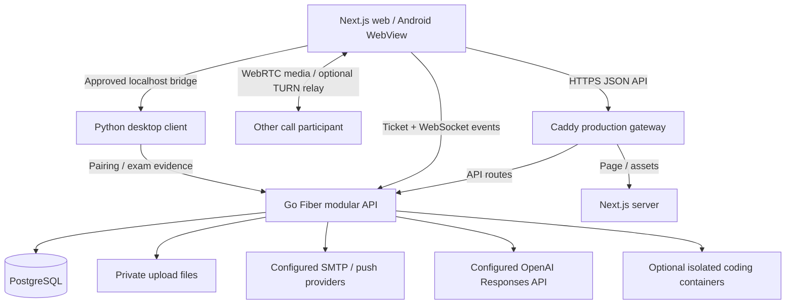
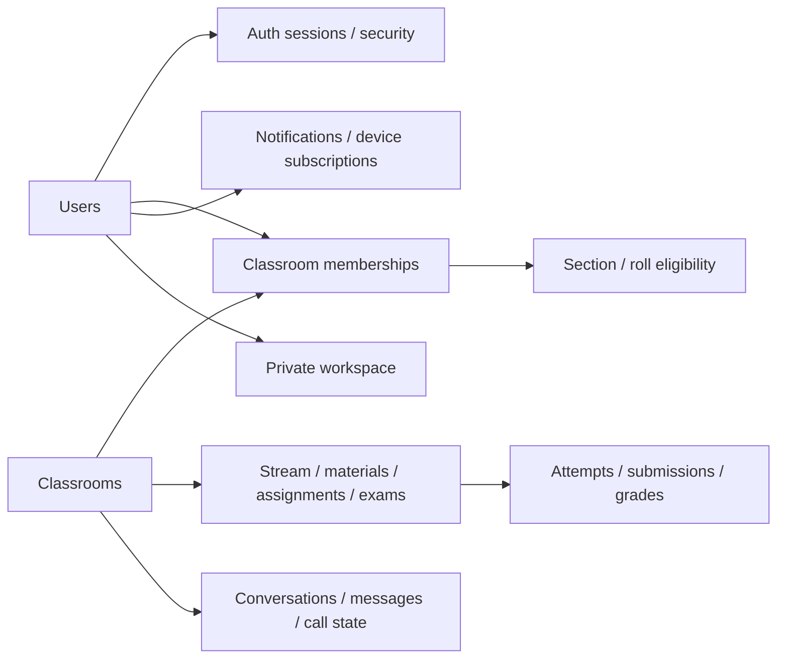

# EduNexus: নিজে বোঝা ও judge-কে বোঝানোর পূর্ণ walkthrough

এই guide-এর code snapshot **88658db**। এটি নতুন feature-এর proposal নয়; ওই snapshot-এর implementation-এর পাঠ। Runtime feature বদলানো হয়নি। Security-এর বিস্তারিত companion হলো [Security ও কঠিন judge প্রশ্ন](security-and-judge-bn.md)।

প্রথমে এই guide পড়ুন, তারপর security guide, তারপর প্রয়োজন অনুযায়ী [backend](../reference/code-map-backend.md), [frontend](../reference/code-map-frontend.md) ও [database/runtime](../reference/code-map-data-runtime.md) index খুলুন। Index-এর প্রতিটি symbol-এর permalink একই snapshot-এর নির্দিষ্ট source line খুলবে। মোট ৮৮৬টি tracked source/config/test text file তালিকাভুক্ত: ৬৫৩টি source/config, ১১৭টি test, ১৩টি generated এবং ১০৩টি vendored file। এগুলোকে সব নিজের লেখা business logic বলা যাবে না। Images, binaries, lockfiles ও historical archive এই structural count-এর অন্তর্ভুক্ত নয়।

## ১. আগে পুরো ধারণা

EduNexus একটি classroom ও coursework management application। Teacher class তৈরি করেন, student যোগ দেন, তারপর একই class context-এর মধ্যে materials, announcements, assignments, attendance, exams, grading, messaging এবং learning support ব্যবহার করেন। Institution যুক্ত করা optional; institution ছাড়া class চলতে পারে। Advanced targeting-ও optional; default audience Everyone।

তিন ধরনের client আছে:

1. **Web:** Next.js/React UI; desktop ও responsive mobile browser।
2. **Android:** Java WebView app, একই web application দেখায়; permissions, push, downloads, updates ও call integration-এর native সহায়তা দেয়। এটি আলাদা React Native/Flutter product নয়।
3. **Desktop exam client:** Python native client; অনুমোদিত exam monitoring, browser pairing ও optional trusted Windows tester-এর জন্য। পুরো classroom UI আবার Python-এ লেখা হয়নি।

Backend একটি **modular monolith**: একটি Go/Fiber process-এর মধ্যে আলাদা feature module। Auth, classroom, exam, learning, messaging ইত্যাদি directory আলাদা হলেও আলাদা deployed microservice নয়। একাধিক backend instance চালানো deployment-এর বিষয়; folder ভাগ করলেই microservices হয় না।



Local development-এ Caddy বাধ্যতামূলক নয়। Browser `/api/...` request করলে Next-এর proxy সেটিকে Go backend-এ পাঠায়। Production base Compose-এ Caddy `/api` সরাসরি Go-তে পাঠায়।

## ২. যে শব্দগুলো আগে জানা দরকার

| শব্দ | এখানে অর্থ |
|---|---|
| Frontend | ব্যবহারকারীর দেখা UI, forms, navigation ও browser state |
| Backend | পরিচয়, permission, validation ও data mutation-এর authoritative server |
| HTTP / JSON | client-server request/response এবং তার structured data format |
| Route | method + URL কোন handler চালাবে: যেমন POST login |
| Middleware | handler-এর আগে/পরে চলা shared কাজ: auth, rate limit, logging |
| Handler | HTTP input বোঝে, operation চালায়, status/JSON ফেরত দেয় |
| Service | business rule ও operation orchestration |
| Repository | data access-এর abstraction; সব module-এ এই layer নেই |
| DTO / type | request/response-এর প্রত্যাশিত shape; runtime validation-এর বিকল্প নয় |
| Migration | database structure-এর versioned change |
| Transaction | একাধিক database change সব সফল হবে, নইলে rollback হবে |
| Cache | দ্রুত দেখানোর copy; permission বা final truth নয় |
| Session | server-এর কাছে একটি login/device-এর tracked validity |
| JWT | client বহন করে এমন signed access token |
| Idempotency | একই operation retry হলেও duplicate effect না হওয়া |
| Revision / CAS | যে version পড়েছিলাম সেটি এখনও current হলেই write করা |
| WebSocket | server event দ্রুত client-এ পৌঁছানোর persistent connection |
| WebRTC | browser/native media connection; WebSocket-এর সমার্থক নয় |

## ৩. কোন folder কেন আছে

| Folder/file | কাজ | কীভাবে পড়বেন |
|---|---|---|
| `backend/apps/api/main.go` | চলমান Go API-এর entry point | শুরুতেই পড়ুন |
| `backend/internal/platform/` | config, DB, JWT, middleware, router, common infrastructure | boot ও trust boundary বুঝুন |
| `backend/internal/auth/` | account/authentication | routes → handler → service → repository |
| `backend/internal/classroom/` | core classroom/membership/stream | একই layer pattern |
| `backend/internal/exam/` | exam, attempt, question, monitoring, runner | register → operation → SQL/validation |
| `backend/internal/learning/` | assignment/material/workspace ও academic extensions | feature অনুযায়ী file |
| `backend/internal/messaging/`, `calling/`, `realtime/` | conversation, calls, event transport | REST state ও event আলাদা করে পড়ুন |
| `backend/internal/notifications/` | in-app, email digest ও push workflows | preferences → outbox/delivery |
| `database/migrations/` | schema evolution | feature table ও constraints |
| `database/queries/` | sqlc-এর source queries | generated Go-এর আসল SQL |
| `backend/internal/platform/database/sqlc/` | generated typed queries | input/output দেখুন; হাতে edit করবেন না |
| `frontend/app/` | routes, root layout, global styles, API proxy | URL কোথায় render হয় |
| `frontend/components/` | feature UI ও reusable controls | user interaction |
| `frontend/services/` | typed API wrappers | কোন endpoint call হয় |
| `frontend/lib/` | HTTP, import, offline, call ও shared algorithms | reusable behaviour |
| `frontend/providers/`, `store/` | application-wide lifecycle/state | login, cache, calls, preferences |
| `frontend/tests/` | browser-independent regression tests | edge case ও expected behaviour |
| `frontend/public/` | public icons, workers, SW, downloads | private uploaded files এখানে নয় |
| `android-app/` | Android Java wrapper ও release/build integration | native permission/update boundary |
| `desktop-client/` | Python client, local bridge, tester protocol | desktop-only responsibilities |
| `chrome-extension/` | exam browser evidence extension | consent ও collected data |
| `deploy/` | production containers, HTTPS, migrations, backup, TURN | deployment contract |
| `scripts/dev/`, `scripts/qa/`, `scripts/database/` | operator tooling | source feature নয় |
| `.github/workflows/` | automated verification/build | কোন checks CI চালায় |
| `docs/` | explanation, runbooks, verification records | historical vs current আলাদা করুন |
| `archive/` | পুরোনো scaffold/reference | active architecture-এর প্রমাণ হিসেবে ব্যবহার নয় |
| `release-builds/`, `uploads/` | local generated artifacts/private storage | source নয়; Git-এ সাধারণত ignored |

Filename-এর `phase`, `violet` বা পুরোনো naming দেখেই runtime behaviour অনুমান করবেন না। উদাহরণ: `violet.css` নাম থাকলেও বর্তমান theme brown tokens ব্যবহার করতে পারে। `.bak` file active component ধরে পড়বেন না; import/registration দেখুন।

## ৪. Server boot: একটি file সত্যিই line ধরে পড়া

[`main.go`](../../backend/apps/api/main.go)-এর snapshot-এ:

| Line | কী হচ্ছে | কেন দরকার |
|---|---|---|
| 1–10 | Swagger metadata | API documentation; security enforcement নয় |
| 12 | `package main` | executable package |
| 14–22 | imports | boot-এ ব্যবহৃত modules |
| 24 | `main()` | executable শুরু |
| 25 | logger তৈরি | startup/error visibility |
| 26–29 | config load ও validation failure-এ exit | invalid secret/config নিয়ে server না চালানো |
| 31 | DB config তৈরি | environment থেকে connection settings |
| 33–38 | PostgreSQL pool connect; failure fatal | data layer ছাড়া API ready নয় |
| 39 | deferred pool close | process shutdown-এ cleanup |
| 40–48 | production security migration check | shared auth budgets schema ছাড়া production refuse |
| 50–51 | connection log | operator feedback |
| 53–58 | JWT service তৈরি | signing/verification dependency |
| 60 | Fiber server তৈরি | middleware ও routes register |
| 62–66 | app/env/port log | কোন instance চলছে বোঝা |
| 68–72 | configured port-এ listen | incoming HTTP request গ্রহণ |

`server/server.go` Fiber body/time limits, observability, middleware ও headers বসায়। `router/router.go` dependency wiring করে: pool → queries/repositories → services → handlers → routes। JWT session checking configure হয়; learning-এর staff policy যুক্ত হয়। Realtime ticket route general messaging prefix middleware-এর আগে register হওয়ার কারণ browser WebSocket API-তে custom Authorization header দেওয়া যায় না।

Auth/classroom-এর layer আছে বলে সব module-এ repository/service আছে বলা ভুল। Exam/learning-এর অনেক handler সরাসরি parameterized pgx SQL ব্যবহার করে। এটি বর্তমান বাস্তব tradeoff; ভবিষ্যৎ refactor-এর জায়গা আছে।

## ৫. একটি login পুরো application দিয়ে যেভাবে যায়

1. Login component form input নেয়। Client validation দ্রুত feedback দেয়।
2. `frontend/services/auth.ts` typed request তৈরি করে।
3. `frontend/lib/api.ts` shared Axios client same-origin `/api` call পাঠায়।
4. Development Next proxy configured backend origin-এ পাঠায়; production Caddy gateway Go-তে পাঠায়।
5. Auth route/handler body parse ও validation করে। Production auth budget brute-force pressure সীমিত করে।
6. User service account load করে, bcrypt দিয়ে password check করে। MFA enabled হলে factor/recovery validation দরকার।
7. Server session ও hashed refresh capability তৈরি করে; short-lived signed access JWT ফেরত দেয়।
8. UI auth state ও persisted token state update করে; protected request-এ `Authorization: Bearer ...` যায়।
9. JWT middleware signature/expiry **এবং live session/account validity** check করে। এরপর feature-level authorization হয়।
10. Access token expire হলে Axios shared refresh promise ব্যবহার করে। অনেক request একসঙ্গে 401 পেলেও একই rotation result ভাগ করে; stale session response নতুন account-এর token overwrite করতে পারে না। Invalid refresh logout করে; temporary network/server failure-কে স্থায়ী logout হিসেবে ধরা হয় না।

**উদাহরণ:** Student A valid token দিয়ে Student B-এর private assignment URL call করলেও login valid হওয়া যথেষ্ট নয়। সংশ্লিষ্ট class membership, content audience এবং ownership check pass করতে হবে। Login হলো “তুমি কে”; authorization হলো “এই object-এ তুমি কী করতে পারবে”।

### আরেকটি বাস্তব উদাহরণ: assignment list/save-এর code

এই example-এ frontend type থেকে server permission ও SQL পর্যন্ত একই operation ধরা যায়:

| File / line | কী পড়বেন |
|---|---|
| `frontend/services/assignments.ts` 6–19 | Assignment type: audience, rubric, deadline, points ও publish status |
| একই file 34 | Class-specific URL তৈরি |
| 36–41 | List fetch; cachedResource-এর account/offline policy-এর ভেতরে API GET |
| 43–46 | ID থাকলে PUT update, না থাকলে POST create |
| 48–59 | Deadline change-এ expected previous value ও reason পাঠায় |
| 75–89 | FormData submission; browser-কে multipart boundary তৈরি করতে দেয় |
| `backend/internal/learning/handler.go` 109–118 | JWT-protected route group ও list/save/publish/submit/grade/file handlers |
| একই file 124–137 | Caller ID Locals থেকে; UUID validate; active class membership parameterized query |
| `backend/internal/learning/assignments.go` 19–32 | Server data shape; frontend type থাকলেও server আলাদা validate করে |
| 34–44 | Title/size/date/points, future publish time, audience ও rubric validation |
| 46–50 | List-এর আগে membership check; failure হলে সঙ্গে সঙ্গে return |
| 51 | Class scope, draft/published role filter, personal due date ও resource visibility SQL-তে |
| 55–65 | Rows close, scan ও iteration error handling |
| 67 | Successful JSON response |
| 69–79 | Save-এর আগে teacher-level membership; body parse ও validation |
| 81–89 | Empty rubric normalization, audience encode; absent update audience আর explicit policy আলাদা |
| 90–97 | Transaction begin, deferred rollback, audit actor/reason context |
| 98–106 | New assignment insert অথবা class-scoped row lock নিয়ে existing assignment load |

এখানে judge-কে বলবেন: “UI-র type developer mistakes কমায়, কিন্তু attacker raw HTTP পাঠাতে পারে। তাই server membership ও validation আবার করছে। SQL-তে class ID value binding আছে এবং list-এ visibility function আছে। Transaction-এর পরের অংশে schedule/status rules ও commit পড়তে হবে; শুধু insert দেখে পুরো flow বোঝা শেষ নয়।” এই পদ্ধতিতে index থেকে প্রতিটি feature-এর function ধরে এগোবেন।

## ৬. Frontend কীভাবে সাজানো

[`app/layout.tsx`](../../frontend/app/layout.tsx)-এ line 1–19 imports, 21–33 viewport/metadata, 35–59 root component। Line 43–55-এ preferences/theme/query context এবং offline, error monitor, realtime, push, update, call lifecycle mount হয়। `SiteChrome` shared navigation-এর ভেতরে current page দেখায়।

`app/.../page.tsx` route entry। বড় feature components-এ form/list/action থাকে; `services/*.ts` HTTP contract জানে। `lib/` complex shared logic রাখে।

State তিনভাবে বুঝুন:

- **Server state:** TanStack Query; list/detail data, cache, invalidation। Mutation সফল হলে relevant query refresh হয়। Account change-এ cache clear হওয়া privacy-এর জন্যও জরুরি।
- **Shared client state:** Zustand auth state, provider-managed calls/preferences ইত্যাদি।
- **Local state:** open modal, typed text, selected filters; React component/hook। সব state global করা প্রয়োজন নেই।

`AuthGuard` login hydration/redirect/offline UX সামলায়। এটি backend permission check-এর বিকল্প নয়। `lib/classroom-tab.ts` tab URL-এ রাখে, তাই attendance/exam refresh করলে stream-এ ফিরে যাওয়ার বদলে selected tab থাকে। `lib/return-path.ts` internal return URL allowlist করে।

UI-তে semantic color tokens, shared button/dialog/skeleton, responsive navigation, mobile safe areas এবং compact class/workspace layout আছে। Logo component approved image দেখায়; dark mode CSS rim/halo visibility বাড়ায়। Theme toggle visual preference বদলায়; server permission বদলায় না।

## ৭. Feature-by-feature reading map ও working pattern

নিচের প্রতিটি entry-এর exact functions ও line [backend index](../reference/code-map-backend.md) এবং matching UI/service [frontend index](../reference/code-map-frontend.md)-এ আছে।

### Account, profile ও security

`auth/` register, login, refresh, logout, profile, password change/reset ও email verification চালায়। `auth/service/account_security.go` sessions, MFA, recovery ও secure rotation যোগ করে। Email unverified prompt একটি UI decision; email verification record server-এর। Password browser-এ hash করে পাঠানোই নিরাপত্তার ভিত্তি নয়—HTTPS transport এবং server bcrypt প্রয়োজন।

### Class creation ও enrollment

`classroom/` core class/membership; enrollment routes ও associated services join policy চালায়। Teacher direct join অথবা approval, enabled/expiring code, QR/share ও email invitation বেছে নিতে পারেন। Invitation গ্রহণে matching account/email ও applicable rules যাচাই হয়। Bulk roster/CSV preview ও commit আলাদা; preview success মানেই পরে authorization/version check বাদ নয়।

Class owner, co-teacher ও student-এর ক্ষমতা আলাদা। Global instructor role থাকলেই অন্য teacher-এর class owner হওয়া যায় না। Archive historical class সরায়; trash/restore deletion workflow আলাদা।

### Optional sections ও roll audience

`platform/audience/rule.go`, `learning/audience.go`, `sections.go`, `section_bulk.go`, `student_view.go` পড়ুন। UI `audience-fields.tsx`, section settings ও preview ব্যবহার করে।

- কোনো advanced setting না দিলে **Everyone**।
- Section, odd/even roll, roll range, custom selection দিয়ে narrowed audience করা যায়।
- Teacher preview-তে কারা selected/excluded তা দেখেন।
- Rule server-এ normalize/validate হয় এবং content/exam access-এ enforce হয়; শুধু card লুকানো নয়।

উদাহরণ: ১০০ জনের class-এ exam range ১–৫০ করলে roll ৭৫-এর student direct attempt request করেও eligible হবে না। Personal timing audience bypass করে না। User-facing ধারণা **section**; সাধারণ chat group-এর সঙ্গে গুলিয়ে বলবেন না।

### Stream, announcements ও materials

Core stream ও `learning/announcements.go`, `content_schedules.go`, `topics.go`, `accessible_materials.go` দেখুন। Teacher compact composer খুলে content author করেন; list থেকে authoring state আলাদা। Draft, scheduled release, topics/weeks, pin/edit/delete, filters ও material organisation আছে। Materials-এর metadata DB-তে, private files filesystem-এ থাকতে পারে। Download handler membership/audience পরীক্ষা করে।

Accessible content-এ alt/plain text/transcript/caption metadata যুক্ত করা যায়; এগুলো automatic perfect accessibility guarantee নয়। PDF/image preview ও saved material UX permission ও storage policy মানে।

### Assignments, grading ও academic review

`learning/assignments.go`, `bulk.go`, `grading_tools.go`, `gradebook.go`, `rechecks.go`, `similarity.go`, `reports.go` মূল reading path।

Teacher draft→publish করেন; student text/files জমা দেয়, revision/history ও deadline rules চলে। Offline draft স্থানীয়ভাবে রাখা যায়; reconnect-এ current permission, deadline ও version যাচাই ছাড়া final submission অনুমোদিত হয় না। Individual accommodations optional। Rubric/feedback templates, marks import preview/commit, submission bundle, reminder, gradebook, recheck ও academic reports আছে। Similarity একটি review signal; plagiarism-এর চূড়ান্ত প্রমাণ নয়।

Attachment storage সব feature-এ এক নয়: কিছু file filesystem, কিছু binary DB row-এ। তাই শুধু uploads folder অথবা শুধু database backup নিলে সব recover হবে—এমন ধরে নেওয়া যাবে না।

### Attendance, progress ও analytics

Attendance editor, `learning/progress.go`, `progress_coursework.go`, `analytics.go` ও question analysis files পড়ুন। Membership/role অনুযায়ী teacher editing ও student viewing আলাদা। Derived totals শেখার সহায়তা দেয়; attendance/marks input ভুল হলে chart সুন্দর হলেই ফল সঠিক নয়। Export/report snapshot-এর source ও publish state বিচার করতে হবে।

### Question bank ও import

`frontend/lib/question-import.ts`, `question-import-files.ts`, `question-ocr.ts`; UI `question-import*.tsx`, `question-bank.tsx`; backend exam question-bank files।

Question-এর প্রধান kind MCQ, theory, coding। MCQ-তে single/multiple/dropdown presentation, options, correct key, explanations, images, math, difficulty ও taxonomy থাকে। Shuffled display index এবং canonical answer index আলাদা রাখতে হয়, নইলে grading ভুল হবে।

CSV/TSV, JSON, TXT/Aiken, DOCX, XLSX, selectable PDF এবং OCR image/scanned PDF extraction আছে। Pipeline: **file limits → parse/extract → normalize → editable preview → validate → explicit import/save**। OCR ভুল করতে পারে; missing answer key বানিয়ে নেওয়া হয় না। Spreadsheet formula execute করা হয় না। Import limit ও exam question limit আলাদা (এই snapshot-এ ১০০ ও ৪০); import হলো bank তৈরির সুবিধা, সব প্রশ্ন এক exam-এ ঢোকানোর অনুমতি নয়।

Google Forms-এর মতো authoring/import সুবিধা নিজের parser/UI-তে তৈরি; Google Forms API connection বা Google account sync দাবি করা যাবে না।

### Exam lifecycle ও recovery

`backend/internal/exam/` register/handler/attempt/version/management-related files এবং UI `exam-creator`, `exam-readiness`, `exam-entry-gate`, `exam-take`, `exam-results` পড়ুন।

Lifecycle: draft questions/settings → readiness/preview → publish → eligibility/preflight → start attempt → revisioned save → submit/expiry → grading → result release/review। Question sets-এর approval snapshot ও source version stale content এড়াতে সাহায্য করে। Published/edit rules attempted exam-এর integrity রক্ষা করে।

Server clock deadline নির্ধারণ করে। UI countdown শুধু display। Save revision/CAS stale overwrite ঠেকায়; idempotent recovery retry duplicate attempt/mutation কমায়। Browser draft recovery মানে student ইচ্ছেমতো expired exam reopen করতে পারে না। Phone MCQ entry teacher opt-in; coding exam desktop policy আলাদা।

### Coding exam, execution ও optional tester

Monaco editor, workspace files/entry point/stdin → coding service → backend runner → constrained Docker execution → bounded output। Execution output ও final submitted answer এক জিনিস নয়। Runner enable/image setup প্রয়োজন; deployment Compose চালালেই default coding execution available বলা যাবে না।

Teacher optional `.exe` tester attach করতে পারেন; না দিলে question আটকে যায় না। Server metadata/hash ও file shape check করে; download ticket/local bridge/approval দিয়ে desktop client চালায়। `desktop-client/TESTER_PROTOCOL.md` input/output contract। Windows Job process/memory/lifetime controls দেয়; hostile executable containment-এর পূর্ণ sandbox নয়। Production trusted-native-testers opt-in default off।

### Exam monitoring

Chrome extension browser consent/evidence সংগ্রহ করে; desktop client foreground process/approved clipboard-related telemetry দেয়। Pairing/attempt scope server check করে। এটি browser/native cooperation-এর evidence system; device-এর সব cheating detect করার প্রতিশ্রুতি নয়। Screenshots, সব keystroke বা private chat পড়া হচ্ছে—এমন দাবি করবেন না। Collected field-এর actual schema দেখান।

### Messaging

`messaging/` REST operations, `realtime/` events, `frontend/services/messaging.ts`, messaging components ও providers পড়ুন। Conversation class-scoped teacher↔student; arbitrary student↔student social network নয়।

Text, file, voice, shared themes, emoji sizing, swipe reply, quoted replies, reactions, read state, search, edit/delete, saved/starred items, shared pin/media, mute, upload retry এবং moderation rules আছে। Teacher class-wide/specific-student messaging permissions নিয়ন্ত্রণ করতে পারেন। Personal star/mute ও shared theme/pin-এর visibility এক নয়।

REST+DB authoritative state। WebSocket typing/invalidation event দ্রুত দেয়; event পেলেই client permission ছাড়া যেকোনো message পড়তে পারে না। Reconnect-এর পরে persisted state আবার fetch হয়।

### Voice/video calls

`calling/`, `frontend/lib/call-engine.ts`, call provider এবং Android bridge পড়ুন। Signaling backend offer/answer/ICE ও call state আদানপ্রদান করে। Microphone/camera stream browser WebRTC দিয়ে peer বা TURN relay-এ যায়; Go API সাধারণত media packets relay/record করে না। STUN address discovery; TURN restrictive NAT-এ relay।

HTTPS secure context এবং user media permission দরকার। Laptop localhost exception ফোনের `http://192.168...` URL-এ প্রযোজ্য নয়। Background call/push OS ও configured Firebase integration-নির্ভর; browser test দিয়ে সব handset behaviour certify করা যায় না।

### Notifications

`notifications/notifications.go`, `list.go`, `digests.go`, `push.go`, `push_sender.go` পড়ুন। In-app records, read/preferences, digest modes, reminders ও delivery retry/dedup আছে। SMTP configure হলে email; VAPID হলে web push; FCM credentials/device opt-in হলে Android push। UI option থাকা মানেই provider configured বা delivery guaranteed নয়। Mute conversation মানে সব call automatically block নয়।

### AI tutor

`learning/tutor.go`, tutor service/component পড়ুন। Server classroom-visible sources/excerpts থেকে context তৈরি করে, configured OpenAI Responses API call করে, citation validation ও private history রাখে। API key browser bundle-এ যায় না। Request identity/quotas duplicate spending ও uncontrolled usage কমায়। Active exam restrictions আছে।

এটি নিজের model train করা নয়। Source excerpts-ভিত্তিক grounding আছে বলে model-এর প্রতিটি উত্তর সঠিক হয় না। Code-এ vector embeddings/database না থাকলে “vector RAG engine” বলবেন না। Teacher/student source ও citation যাচাই করবেন।

### Workspace ও optional institutions

`workspace.go`, `task_inbox.go`, `calendar.go`, `search.go`, `personal_workspace.go`, `semesters.go`, institution files দেখুন। Home overview, teaching/learning class cards, upcoming tasks, calendar/reminders, private notes/checklists/files, planner, global search, storage, trash, semester archive/rollover ও institution roles আছে। Rollover নতুন draft coursework তৈরি করতে পারে; পুরোনো student marks নতুন cohort-এর নামে কপি করা উচিত নয়। Institution membership ও classroom membership আলাদা permission context।

### Activity history ও operations

`learning/activity.go` teacher actions-এর actor/time/reason context দেয়। Audit history debugging/accountability-তে কাজে লাগে; database administrator বদলাতে পারবেন না এমন cryptographic immutable ledger নয়। Error monitor structured diagnostic পাঠায়, auth/secrets বা ব্যক্তিগত message ঢেলে পাঠানো উচিত নয়। Release/update/backup tools operational reliability-এর অংশ।

## ৮. Database কীভাবে বুঝবেন

এই snapshot-এ ৫৮টি `.up.sql` migration আছে। [Data/runtime map](../reference/code-map-data-runtime.md)-এ প্রতিটি migration এবং SQL object-এর line আছে। সব migration-এর reverse file নেই; arbitrary rollback supported ধরে নেবেন না।

Entity relationships দিয়ে পড়ুন:



এটি conceptual relation map; exact table/foreign-key name migration-এ দেখুন।

`database/queries/*.sql` → `backend/sqlc.yaml` → generated Go query methods। Placeholder `$1`-এর value binding SQL syntax থেকে user value আলাদা রাখে। Inline SQL-ও আছে; সব query sqlc-generated নয়।

Transaction example: submission insert, revision update ও related status পরিবর্তন একসঙ্গে সফল হতে হবে। `FOR UPDATE` concurrent refresh/reset/grade operations serialize করতে পারে। Unique constraint duplicate membership ঠেকায়। CAS revision stale client overwrite ঠেকায়। Foreign key সম্পর্ক অক্ষত রাখে। এগুলো আলাদা সমস্যা সমাধান করে; একটি দিয়ে অন্যটি replace হয় না।

Soft delete record retain করতে পারে; archive visibility/workflow বদলায়। Neither is a backup। Database migration schema বদলায়; code deploy binary বদলায়। Compatible schema ছাড়া নতুন binary শুরু করলেই correctness নিশ্চিত নয়।

## ৯. Docker: শুরু থেকে production পর্যন্ত

### প্রয়োজনীয় ধারণা

- **Image:** app/dependencies-এর build artifact।
- **Container:** image-এর running instance।
- **Dockerfile:** image বানানোর recipe।
- **Compose:** related services/networks/volumes একসঙ্গে চালানোর declaration।
- **Volume:** container replacement-এর পরও data রাখে।
- **Network:** services কোন address দিয়ে কথা বলবে ও কোথায় reachable হবে।

Container delete এবং database volume delete এক জিনিস নয়। `docker compose down -v` data মুছে ফেলতে পারে; routine restart command হিসেবে ব্যবহার করবেন না।

### Local setup

Root [`docker-compose.yml`](../../docker-compose.yml) শুধু infrastructure চালায়:

| Service | Host port | ভূমিকা |
|---|---|---|
| PostgreSQL 17 | 5432 | চলমান application-এর primary DB |
| Redis 8 | 6379 | local infrastructure-এ provisioned; current app client wiring পাওয়া যায়নি |
| MinIO | 9000 / 9001 | object-storage service/console provisioned; current API storage adapter নয় |

Redis/MinIO container চলা মানেই notification queue বা uploaded files এগুলোতে যাচ্ছে নয়। Current source PostgreSQL ও private filesystem ব্যবহার করে। Judge-কে এই distinction বলুন।

`scripts/dev/start-local.ps1` local Docker readiness ও dependencies check করে, PostgreSQL/Redis/MinIO start করে, native Go API ও Next frontend চালায়, health/page/assets verify করে, process ownership/logs রাখে। Web default 3000, API 8080। Docker Desktop window open হওয়া ও Docker CLI engine reachable হওয়া আলাদা; bounded `docker info` failure launcher-কে থামাতে পারে।

```powershell
cd F:\EduNexus
.\scripts\dev\start-local.ps1
.\scripts\dev\start-local.ps1 -Action Status
```

`-Restart` owned app processes restart করার জন্য; database reset নয়। `-SkipInfrastructure` ব্যবহার করলে dependencies আগে থেকেই usable হতে হবে। Local `-Production` frontend production build-এর mode; backend-এর `APP_ENV=production` validation স্বয়ংক্রিয়ভাবে একই জিনিস ধরে নেবেন না।

`scripts/database/initialize-local.sh` নতুন empty database initialize করে। Existing data volume-এ init scripts আবার সব migration চালাবে না। Established database upgrade-এর জন্য documented migration procedure দরকার।

### Production stack

[`deploy/compose.yml`](../../deploy/compose.yml): PostgreSQL → migration job সফল → Go API → Next frontend; Caddy public gateway। PostgreSQL host port publish করে না, private database network আছে। API uploads volume persistent। API/frontend read-only filesystem, non-root user, dropped capabilities ও no-new-privileges ব্যবহার করে।

Go Dockerfile multi-stage: dependencies/build → ছোট runtime image। Frontend Node build → Next standalone runtime। Container-এর ভেতরে `localhost` ওই container-কে বোঝায়; frontend থেকে backend হলো `http://api:8080`, database হলো `postgres:5432`। Host-এর `localhost:8080` addressing আলাদা।

Caddy HTTPS certificates/TLS, reverse proxy, security headers ও trusted client metadata সামলায়। `/api/*` prefix strip করে API-তে পাঠায়; `/messaging/socket` WebSocket routing আছে; বাকি frontend।

Optional runner override Docker socket access দেয়; এটি powerful daemon access। Coding execution host আলাদা রাখা ভালো; base stack-এর default mount নয়। Optional TURN override media relay infrastructure দেয়। Optional recovery/backup tooling DB, upload files ও verification checksums নিয়ে কাজ করে।

### Data persistence ও backup

Image rebuild-এ named volume মুছে যায় না। কিন্তু disk failure, accidental deletion বা compromised database থেকে volume নিজে রক্ষা করে না। Backup-এ DB এবং corresponding uploads লাগতে পারে। Verify procedure disposable database-এ restore করে; production live data overwrite করে পরীক্ষা নয়। Backup encryption, offsite retention, restore time ও operator access deployment policy দিয়ে নিশ্চিত করতে হবে।

## ১০. Android, desktop ও extension বিস্তারিত পড়ার নিয়ম

Android-এর `MainActivity.java` দিয়ে শুরু করুন: WebView settings, URL/origin checks, permission callbacks, JS bridges, download/update integration। `UpdatePolicy.java` ও `AppUpdateManager.java` version/package/hash/signature checks দেখায়। Same hosted web UI বদলালে wrapper নতুন UI দেখাতে পারে; native code/permission/signing change হলে নতুন APK দরকার। Public download binary source edit করলেই rebuild হয় না।

Desktop-এর `client.py` UI/lifecycle/pairing; `local_bridge.py` browser-to-native boundary; `test_runner.py` approved tester execution/protocol; `windows_job.py` process lifetime/resources। আগে protocol পড়ুন, তারপর callers। Extension-এর manifest permissions ও message handlers পড়ে কোন evidence collection allowed তা বুঝুন।

## ১১. Configuration, build ও checks

Server-only environment: DB password, JWT/proxy/MFA keys, OpenAI key, SMTP/FCM secrets। `NEXT_PUBLIC_*` frontend bundle-এ প্রকাশযোগ্য; সেখানে secret রাখবেন না। `.env` ও signing keys report/presentation/Git-এ দেবেন না।

Frontend-এর verified scripts:

```powershell
cd F:\EduNexus\frontend
npm run check
npm run build
```

`check` lint + TypeScript + Node regression tests। Build bundling/render contract ধরে; browser usability সব প্রমাণ করে না। Go checks-এর জন্য backend directory-তে `go test ./...`, `go vet ./...`; database integration checks-এ isolated migrated PostgreSQL ও test configuration দরকার। Race/dependency/fuzz/build checks-এর exact environment `.github/workflows/quality.yml`-এ। Windows-specific loader issue হলে সেটিকে test pass বলে লুকাবেন না; platform-specific result আলাদা রাখুন।

`scripts/qa/`, desktop tests, Android policy tests, deployment isolation ও restore checks দেখুন। Historical verification report-এর pass বর্তমান unrun command-এর pass নয়। এই documentation task-এ নতুন full runtime suite চালানোর দাবি করা হয়নি।

## ১২. Judge-কে একটি file বোঝানোর reusable পদ্ধতি

প্রতিটি file-এর জন্য ছয়টি কথা বলুন:

1. **দায়িত্ব:** এই file কী সমস্যার মালিক?
2. **Caller:** কে invoke/register/import করে?
3. **Input:** user-controlled কী, trusted কী?
4. **Rule:** কোন validation/authorization/invariant আছে?
5. **Effect:** DB/file/network/state-এ কী বদলায়?
6. **Failure ও evidence:** timeout/retry/conflict হলে কী হয়; কোন test সেটা ধরে?

প্রতিটি line-এর punctuation মুখস্থ করার চেয়ে একটি operation-এর path অনুসরণ করুন। Example: “এই DTO text নেয় → handler caller identity পায় → class membership check → audience rule check → transaction/write → response → client query invalidation।” Function body-তে condition, query argument, error branch ও commit line সবচেয়ে মনোযোগ দিয়ে পড়ুন। Import/blank line একই নিয়মে বারবার ব্যাখ্যার প্রয়োজন নেই।

## ১৩. Presentation-এর ব্যবহারযোগ্য ক্রম

### প্রথম ৮–১০ মিনিট

1. Problem ও user: class/coursework/exam একটি coherent workspace-এ।
2. Architecture diagram: web/Android/native → one modular Go API → PostgreSQL/private files।
3. Teacher class create; institution/advanced settings optional।
4. Content/exam audience demo: Everyone বনাম odd/even/range।
5. Student workflow: material → draft/submission → grading/result।
6. Messaging/call: DB-backed conversation, WebSocket events, WebRTC media।
7. Security: identity, object-level permission, race safety, execution boundary।
8. Docker persistence, migration, backup ও honest limitations।

### গভীর technical walkthrough

`main.go` → `server.go` → `router.go` → auth route/service → JWT → one classroom mutation → one exam save/authorization path → SQL migration/query → frontend service/cache → Docker deployment। তারপর judge যেই feature জিজ্ঞেস করবেন index থেকে exact source খুলুন।

### মুখে বলার ছোট introduction

“EduNexus একটি classroom ও academic workflow system। Frontend Next.js/React, backend একটি modular Go/Fiber API, data PostgreSQL ও protected file storage-এ থাকে। Android app একই web product-এর native wrapper; coding exam-এর জন্য আলাদা desktop integration আছে। Advanced section/roll rules optional এবং server-এ enforce হয়। Security-তে login check-এর পাশাপাশি class/object permission, session revocation, MFA, transaction/version control এবং constrained execution আছে। External email, AI, push ও TURN configured হলে সংশ্লিষ্ট integration কাজ করে। এখন একটি user action-এর request path দিয়ে implementation দেখাচ্ছি।”

এখান থেকে [security guide](security-and-judge-bn.md) পড়ুন। কঠিন প্রশ্নে source না দেখে অতিরিক্ত দাবি করার চেয়ে প্রমাণের জায়গাটি খুলে দেখানো বেশি নির্ভরযোগ্য।

## ১৪. Source index-এর scope ও পুনরায় তৈরি

Index-এর symbol extraction declaration-pattern ভিত্তিক; anonymous callbacks, প্রতিটি local arrow function বা dynamic registration আলাদা entry নাও হতে পারে। File link থেকে সম্পূর্ণ source পড়া যাবে। এটি compiler-generated call graph নয় এবং ৮৮৬টি file-এর প্রতিটি executable line-এর semantic annotation নয়। Selected critical files-এর line walkthrough উপরে দেওয়া হয়েছে; অন্য feature-এর জন্য একই input → permission → effect → error পদ্ধতি ব্যবহার করুন।

Committed snapshot থেকে index regenerate করতে:

```powershell
cd F:\EduNexus
python -X utf8 .\scripts\docs\generate-code-map.py --revision 88658db
```

অন্য commit-এর index চাইলে revision বদলান। Generator Git object থেকে source পড়ে; local uncommitted edits বা private `.env` পড়ে না। Source বদলালে guide-এর line tables ও feature claims-ও review করতে হবে; index regenerate করলেই explanatory prose নিজে update হয় না।
